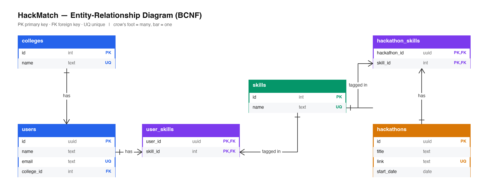
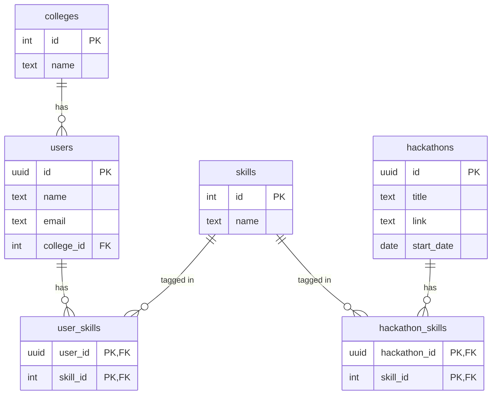

# HackMatch ER Diagram



## Entity-Relationship Diagram (BCNF Schema)

```
                        ┌─────────────┐
                        │   colleges  │
                        │─────────────│
                        │ id (PK)     │
                        │ name UNIQUE │
                        └──────┬──────┘
                               │ 1
                               │
                               │ N
                 ┌─────────────▼─────────────┐
                 │           users            │
                 │───────────────────────────│
                 │ id (PK, UUID)             │
                 │ name                      │
                 │ email (UNIQUE)            │
                 │ college_id (FK→colleges)  │
                 └─────────────┬─────────────┘
                               │ 1
                               │
                               │ N
                 ┌─────────────▼─────────────┐
                 │        user_skills         │
                 │───────────────────────────│
                 │ user_id (PK, FK→users)    │
                 │ skill_id (PK, FK→skills)  │
                 └─────────────┬─────────────┘
                               │ N
                               │
                               │ 1
                 ┌─────────────▼─────────────┐
                 │          skills            │
                 │───────────────────────────│
                 │ id (PK)                   │
                 │ name UNIQUE               │
                 └─────────────┬─────────────┘
                               │ 1
                               │
                               │ N
                 ┌─────────────▼─────────────┐
                 │     hackathon_skills       │
                 │───────────────────────────│
                 │ hackathon_id (PK, FK)     │
                 │ skill_id (PK, FK→skills)  │
                 └─────────────┬─────────────┘
                               │ N
                               │
                               │ 1
                 ┌─────────────▼─────────────┐
                 │         hackathons         │
                 │───────────────────────────│
                 │ id (PK, UUID)             │
                 │ title                     │
                 │ link UNIQUE               │
                 │ start_date                │
                 └───────────────────────────┘
```

## Mermaid ER Diagram



## Relationships Summary

| Relationship | Type | Description |
| :--- | :--- | :--- |
| colleges → users | 1:N | A college has many users |
| users → user_skills | 1:N | A user can have many skills |
| skills → user_skills | 1:N | A skill can belong to many users |
| hackathons → hackathon_skills | 1:N | A hackathon has many skill tags |
| skills → hackathon_skills | 1:N | A skill can tag many hackathons |

The `skills` table acts as the bridge between users and hackathons, enabling the matching engine to do a join on `skill_id` instead of comparing freeform strings.
